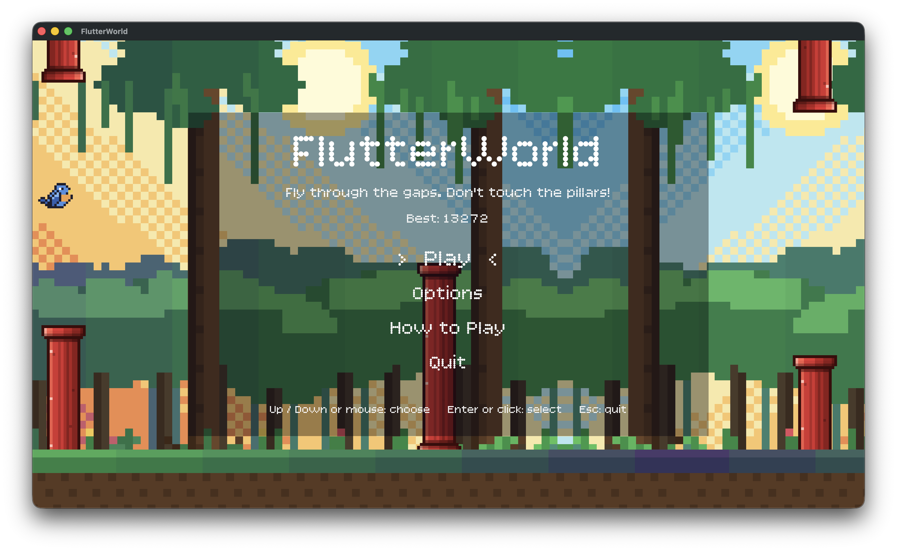
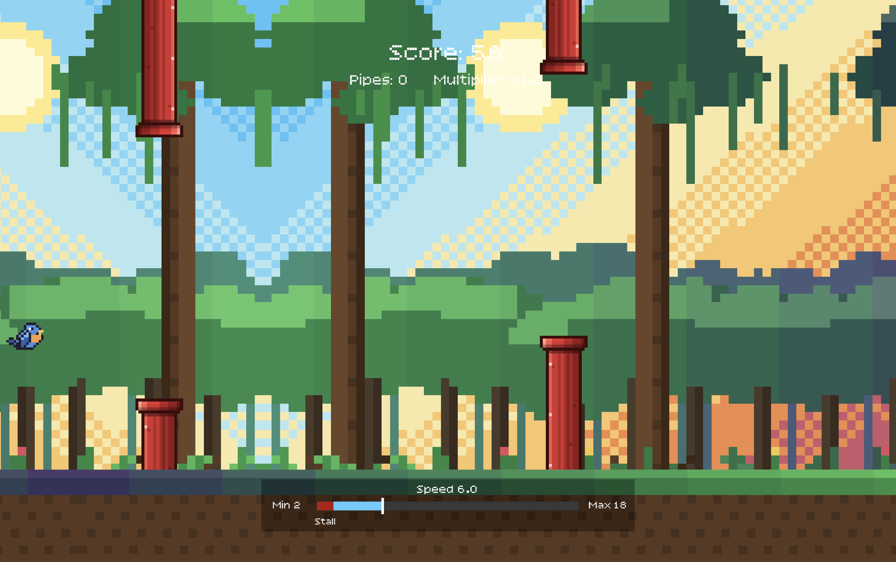

# FlutterWorld

This game is a project I made that took about 2 days to code.
This is my first project for learning Rust (Though I will do more to get familiar with the language)
This project uses the Rusty Game Engine (W rusty engine).
It is a simple fun happy-bird style game.

# NOTICE

This game is still very much in an alpha/beta development phase. **THERE WILL BE BUGS!!!!!!** I will add an HTML file as part of the first stable release so you guys can have it on the internet

# How to Run

1) Install Rust if you don't have it yet (https://rustup.rs)
2) Open a terminal in this folder (the one with Cargo.toml in it)
3) Type "cargo run --release" (without quotes). It'll take a few minutes to compile the first time but then it should be fine

The game has to be started from this folder, because it loads everything from the "assets" folder next to Cargo.toml.

# Controls

| Key | What it does |
| --- | --- |
| Space / left click | Flap |
| G / right click | Glide towards the mouse |
| P | Pause / resume |
| R | Back to the main menu |
| Esc | Quit |

In the menus: Up / Down or the mouse to choose, Enter or a click to select, Left / Right to change a setting, Backspace to go back.

Your best score and your settings are saved automatically.

# Tests

Type "cargo test" to run the tests. They check things like the AI surviving every combination of settings and the game running at the same speed on any monitor.

# Credits

- Music: "Classy 8-Bit" by Eric Matyas, www.soundimage.org
- Sound effects: Kenney (www.kenney.nl), CC0

# Screenshots

# Enjoy!
